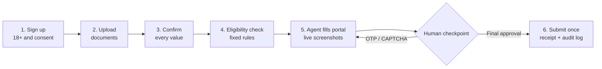
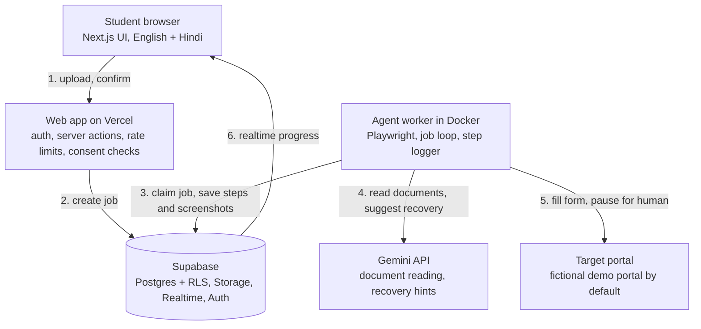

<div align="center">

# Sahayak

### We fill the forms. You make the decisions.

An AI assistant that helps ordinary people complete long, confusing government-style application forms, and always waits for their approval before anything is submitted.


-0A9AD9)

[Live demo](https://sahayak-igjhmfe64-trailblazer6.vercel.app) | [Architecture](docs/ARCHITECTURE.md) | [Deployment guide](docs/DEPLOYMENT.md) | [Security](docs/SECURITY.md)

</div>

> **Independent assistant. Not affiliated with, or endorsed by, any government body.**
> The bundled `/demo-portal` is fictional and says so on every page. Nothing submitted there reaches any real office.

---

## Table of contents

1. [The problem](#the-problem)
2. [Our solution](#our-solution)
3. [Key features](#key-features)
4. [How it works](#how-it-works)
5. [Architecture](#architecture)
6. [Tech stack](#tech-stack)
7. [Project structure](#project-structure)
8. [Safety, privacy and legal design](#safety-privacy-and-legal-design)
9. [What makes Sahayak different](#what-makes-sahayak-different)
10. [Getting started (local)](#getting-started-local)
11. [Deployment (free tier)](#deployment-free-tier)
12. [Environment variables](#environment-variables)
13. [Scripts](#scripts)
14. [Testing](#testing)
15. [The fictional demo portal](#the-fictional-demo-portal)
16. [Benefits, feasibility and cost](#benefits-feasibility-and-cost)
17. [Known limitations](#known-limitations)
18. [Roadmap](#roadmap)
19. [Team and hackathon](#team-and-hackathon)
20. [License and disclaimer](#license-and-disclaimer)

---

## The problem

Public services such as scholarships, licence renewals and subsidy claims are meant to be free and accessible, but the forms often are not.

- **Legacy portals are a maze.** Many pages, dependent dropdowns, strict formats and session timeouts, and usually no public API.
- **The same data is typed again and again.** One wrong field can mean a rejected application and a missed deadline.
- **OTP and CAPTCHA steps break the flow.** People pay agents or cyber-cafes, or lose days waiting.
- **Rules are scattered.** Many people never learn which schemes they qualify for.

First-generation applicants, rural users, and anyone with weak internet or limited digital skills are hit hardest.

## Our solution

Sahayak (Hindi for *helper*) takes the repetitive, error-prone work off the person and keeps every important decision with them.

1. You upload your own documents once.
2. AI reads them and suggests values. **You confirm every field.**
3. Fixed rules (no AI) check which scheme criteria you meet and what is missing.
4. A browser agent fills the portal live while you watch screenshots of each step.
5. **You** handle the OTP, the CAPTCHA and the final approval.
6. You receive a tracking receipt and a full audit log of what was done.

> This repository ships one service, a **student scholarship**, on a bundled fictional portal. The design is general: any service can be added as a reviewed workflow definition.

## Key features

| Area | What you get |
| --- | --- |
| **Accounts** | Email sign-up and sign-in, password reset, optional Google sign-in, adults-only (18+) onboarding, three separate consent choices |
| **Documents** | Upload with size and real file-type checks, AI extraction, field-by-field confirmation, Aadhaar-number rejection |
| **Eligibility** | Deterministic rules from the service definition, with pass/fail reasons and missing documents |
| **Agent** | Playwright browser agent, scripted workflow first, AI only as a recovery helper, one validated action at a time |
| **Human checkpoints** | OTP, CAPTCHA and final approval always handed to the user; waits up to 10 minutes, then stops safely |
| **Live view** | Step timeline, live screenshots, pause and cancel |
| **Receipt** | Tracking ID, screenshot trail, downloadable PDF, plain-language summary |
| **Audit log** | Every action recorded with redacted values |
| **Privacy controls** | Consent history, data export, one-click account and data deletion, automatic deletion after 24 hours |
| **Languages** | English and Hindi |
| **Compliance pages** | Privacy policy, terms, disclaimer and a grievance page (templates, see [limitations](#known-limitations)) |

## How it works



**Run states:** `QUEUED` -> `EXTRACTING` -> `NEEDS_PROFILE_CONFIRM` -> `PLANNING` -> `EXECUTING` <-> `AWAITING_HUMAN` -> `AWAITING_FINAL_APPROVAL` -> `SUBMITTING` -> `COMPLETED` (with `FAILED`, `CANCELLED` and `PAUSED_EXPIRED` possible from any state).

## Architecture

A browser agent cannot run inside short-lived serverless functions, so the system has three deployable parts that talk only through the database.



Design decisions:

- **No Redis.** Postgres is the queue. The worker claims jobs with `FOR UPDATE SKIP LOCKED`.
- **Live progress** comes from the worker writing `run_steps` rows that the browser receives through Supabase Realtime (protected by row-level security).
- **Human pauses** are stored as `approvals` rows. The worker waits for them with a hard timeout instead of blocking forever.
- **Idempotent submit.** The final submit carries a per-run key, so retries can never submit twice.
- **Provider-neutral AI layer.** Gemini and Claude adapters sit behind one interface; a kill switch (`LLM_DISABLED=true`) turns AI off completely and leaves manual entry.

Full details: [`docs/ARCHITECTURE.md`](docs/ARCHITECTURE.md).

## Tech stack

| Layer | Technology |
| --- | --- |
| Frontend | Next.js 16 (App Router), React, TypeScript, Tailwind CSS, `next-intl` (English and Hindi) |
| Auth, database, files | Supabase: Auth, Postgres (row-level security on every table), private Storage, Realtime |
| Agent | Node.js, Playwright (Chromium), Docker |
| AI | Gemini API (free tier) or Anthropic Claude, behind a provider-neutral client |
| Validation and security | Zod schemas, AES-256-GCM field encryption, HMAC-signed worker calls |
| Quality | Vitest (89 tests), ESLint, TypeScript strict mode, GitHub Actions |
| Hosting | Vercel (web), any Docker host or a laptop (worker), Supabase (data) |

## Project structure

```text
sahayak/
├── apps/
│   ├── web/              Next.js app: site, auth, wizard, live run view, receipts,
│   │                     settings, legal pages, API routes, fictional /demo-portal
│   └── worker/           Agent worker: /health and /wake server, Postgres job loop,
│                         Playwright executor, document extraction, AI adapters
├── packages/
│   └── shared/           Zod schemas, workflow and eligibility engines, action
│                         validator, egress allowlist, redaction, crypto, env schemas
├── supabase/             migrations/, one-paste schema.sql, seed.sql, config.toml
├── config/               brand.ts, services/scholarship_demo.json, demo-portal-geo.json
├── scripts/              doctor, keygen, smoke, seed-demo, generate-sample-docs
├── docs/                 ARCHITECTURE, DEPLOYMENT, SECURITY, PRIVACY_COMPLIANCE,
│                         INCIDENT_RESPONSE
├── e2e/  fixtures/       End-to-end tests and recorded AI responses
├── Dockerfile.worker     Host-agnostic worker image
└── docker-compose.yml    Local development stack
```

## Safety, privacy and legal design

Sahayak is built so that safe behaviour is enforced in code, not only promised in text.

**The agent can never**
- answer a CAPTCHA or an OTP, rotate proxies, or hide that it is automated;
- type a value that is not in the user's **confirmed** profile;
- visit a website outside the allowlist (`ALLOWED_PORTAL_HOSTS`; real portals are off by default);
- submit without a recorded final approval, or submit twice.

**Data protection**
- Adults only (18+); three separate, unticked consent choices that can be withdrawn at any time.
- Profile and extracted-document fields are encrypted with AES-256-GCM. Storage buckets are private and accessed with short-lived signed URLs.
- Row-level security on every table. A user can never read another user's rows or files.
- Documents and screenshots are deleted automatically after `RETENTION_HOURS` (default 24). Users can export or erase everything from Settings.
- Logs store field labels and masked values, never raw personal data.
- No ads, no analytics, no tracking cookies; fonts are self-hosted.

**India-specific choices**
- Designed around the Digital Personal Data Protection Act 2023 and the DPDP Rules 2025 (consent, notice, purpose limitation, erasure, grievance, breach readiness).
- **No Aadhaar numbers are collected or stored.** PDFs that show one are refused.
- No State Emblem, government logos or lookalike branding. The demo portal carries a permanent *fictional* banner.
- Automation only acts on the logged-in user's own application, with their authorisation, with rate limits per user per day.

See [`docs/SECURITY.md`](docs/SECURITY.md), [`docs/PRIVACY_COMPLIANCE.md`](docs/PRIVACY_COMPLIANCE.md) and [`docs/INCIDENT_RESPONSE.md`](docs/INCIDENT_RESPONSE.md).

## What makes Sahayak different

Compared with typical *categories* of tools (not specific products):

| Capability | Autofill and RPA tools | Agents and cyber-cafes | **Sahayak** |
| --- | --- | --- | --- |
| Reads your documents with AI | Rarely | No | **Yes** |
| Human approval before submit | Not by default | Trust the agent | **Always** |
| Respects OTP and CAPTCHA | Often bypassed | Not applicable | **Always hands over** |
| Audit trail and receipt | Logs only | No | **Full, with screenshots** |
| Consent, 18+ and delete anytime | Rare | No | **Built in** |
| Cost to the user | Paid | Fee per form | **Free** |

## Getting started (local)

### Prerequisites

- Node.js 24 (22.12 is the minimum; `.nvmrc` pins 24) and npm
- A free [Supabase](https://supabase.com) project
- A free [Gemini API key](https://aistudio.google.com/apikey), or set `LLM_DISABLED=true` to run without AI
- Docker (optional, for the worker image and `docker compose`)

### 1. Clone and install

```bash
git clone https://github.com/nikh240103026-debug/sahayak.git
cd sahayak
npm ci
npx playwright install chromium
```

### 2. Create your environment file

```bash
cp .env.example .env.local        # Windows PowerShell: Copy-Item .env.example .env.local
npm run keygen                    # prints ENCRYPTION_KEY, WORKER_SHARED_SECRET, CRON_SECRET
```

Paste the three generated values into `.env.local`, then fill the remaining variables (see [Environment variables](#environment-variables)).

### 3. Set up the database

1. Create a Supabase project (the Mumbai region is a good choice for Indian users).
2. Open **SQL Editor**, paste the whole of [`supabase/schema.sql`](supabase/schema.sql) and run it.
3. Under **Project Settings -> API Keys**, copy the project URL, the publishable (or `anon`) key and the secret (or `service_role`) key into `.env.local`.
4. Under **Authentication -> URL Configuration**, set the Site URL to `http://localhost:3000` and add `http://localhost:3000/auth/callback` as a redirect URL.
5. For quick local testing you can turn **Confirm email** off under **Authentication -> Sign In / Providers -> Email**. Turn it back on before any real demo.

### 4. Run it

```bash
npm run dev            # terminal 1: web app on http://localhost:3000
npm run dev:worker     # terminal 2: agent worker on http://localhost:8080
npm run doctor         # terminal 3: health check, every line should show a tick
```

### 5. Try the full flow

```bash
npm run sample-docs    # creates clearly fictional sample documents in ./sample-docs
```

Sign up, finish onboarding, start a scholarship application, upload the sample files, confirm your details and watch the agent fill the demo portal.

> **Windows note:** if `npm run dev` does not see your `.env.local`, copy it to `apps/web/.env.local` as well.

## Deployment (free tier)

| Part | Where | Notes |
| --- | --- | --- |
| Web app | **Vercel** (root directory `apps/web`, Node.js 24.x) | The free Hobby plan is for non-commercial use |
| Database, auth, files | **Supabase** free plan | Free projects can pause when idle; a daily cron pings `/api/health` |
| Agent worker | Any Docker host, or your laptop for demo day | `docker build -f Dockerfile.worker -t sahayak-worker .` |
| Cleanup | Vercel cron (daily) plus the hourly GitHub Actions workflow `retention.yml` | Needs `SITE_URL` and `CRON_SECRET` repository secrets |

Quick outline:

1. Push the repository to GitHub and import it in Vercel. Add every variable from `.env.local`. Set `NEXT_PUBLIC_SITE_URL` and `DEMO_PORTAL_BASE_URL` to your Vercel URL and keep `ENABLE_REAL_PORTALS=false`.
2. In Supabase, add your Vercel URL and `<your-url>/auth/callback` under **URL Configuration**.
3. Build and run the worker, then set `WORKER_URL` and `WORKER_SHARED_SECRET` in Vercel and redeploy.
4. Run `npm run doctor` and `npm run smoke` against the deployed URLs.

The step-by-step guide, free-tier notes and troubleshooting table are in [`docs/DEPLOYMENT.md`](docs/DEPLOYMENT.md).

## Environment variables

Copy `.env.example` to `.env.local`. Never commit the real file.

| Variable | Purpose |
| --- | --- |
| `NEXT_PUBLIC_SITE_URL` | Public URL of the web app |
| `NEXT_PUBLIC_SUPABASE_URL` | Supabase project URL |
| `NEXT_PUBLIC_SUPABASE_ANON_KEY` | Supabase public (publishable or `anon`) key |
| `SUPABASE_SERVICE_ROLE_KEY` | Supabase secret key. **Server and worker only, never in the browser** |
| `ENCRYPTION_KEY` | 32 random bytes, base64 (generate with `npm run keygen`) |
| `WORKER_SHARED_SECRET` | Signs calls from the web app to the worker |
| `CRON_SECRET` | Protects the cleanup route |
| `LLM_PROVIDER` | `gemini` or `anthropic` |
| `GEMINI_API_KEY` / `ANTHROPIC_API_KEY` | Key for the chosen provider (not needed with `LLM_DISABLED=true`) |
| `LLM_MODEL_AGENT`, `LLM_MODEL_FAST` | Model names, for example `gemini-2.5-flash` |
| `LLM_DISABLED` | `true` turns all AI off; users type fields by hand |
| `WORKER_URL` | Public address of the worker |
| `DEMO_PORTAL_BASE_URL` | Where the demo portal is served |
| `ALLOWED_PORTAL_HOSTS` | Extra allowed hosts (empty means the demo portal only) |
| `ENABLE_REAL_PORTALS` | Keep `false` |
| `RETENTION_HOURS` | How long documents and screenshots are kept (default 24) |
| `MAX_RUNS_PER_USER_PER_DAY` | Daily limit per user (default 5) |
| `GRIEVANCE_EMAIL`, `SUPPORT_EMAIL` | Shown on the grievance page; the app will not start without them |
| `NEXT_PUBLIC_ENABLE_GOOGLE_AUTH` | Show Google sign-in when configured |
| `NEXT_PUBLIC_ENABLE_DEMO_LOGIN` | Optional labelled demo shortcut login; keep `false` normally |

> Gemini's free tier may use prompts to improve Google's products. Use only the fictional sample documents with it, never real marksheets or IDs.

## Scripts

| Command | What it does |
| --- | --- |
| `npm run dev` / `npm run dev:worker` | Start the web app / the agent worker |
| `npm run build` | Production build of web and worker |
| `npm run doctor` | Checks environment, database, storage, security rules and the worker |
| `npm run keygen` | Generates the three secrets |
| `npm run smoke` | End-to-end check against a running deployment |
| `npm run seed:demo` | Creates the optional demo login user |
| `npm run sample-docs` | Generates fictional sample documents |
| `npm run db:schema` | Rebuilds `supabase/schema.sql` from the migrations |
| `npm run lint`, `npm run typecheck`, `npm test` | Quality checks |

## Testing

```bash
npm run lint && npm run typecheck && npm test
```

- **89 unit and integration tests** cover encryption, redaction, the action validator, the egress allowlist, eligibility rules, workflow planning, document extraction and the AI adapters.
- **End-to-end tests** run the agent in a real browser against the demo portal with recorded AI responses, including injected failures such as a session timeout and a validation error.
- Negative tests check that the agent refuses unconfirmed values, blocks navigation off the allowlist, ignores prompt-injection text on pages, and cannot submit without approval.

## The fictional demo portal

A deliberately dated, government-style site bundled at `/demo-portal`, with a permanent *FICTIONAL DEMO PORTAL - NOT A GOVERNMENT WEBSITE* banner. It lets the agent be demonstrated safely and reliably. Add `?chaos=1` to switch on the obstacles:

1. Login with a session that expires and requires signing in again
2. Dependent dropdowns (state, district, institution) that load with a delay
3. A popup notice that must be dismissed
4. Strict date and percentage formats that cause a first validation error
5. A file upload with size and type limits
6. A demo CAPTCHA and a demo OTP that force a human handoff
7. A declaration checkbox and a final submit that issues a tracking ID such as `DEMO-SCH-2026-00042`, plus a status-check page

## Benefits, feasibility and cost

- **Benefits:** saves hours of repetitive typing, reduces errors that cause rejection, helps first-time and rural users, avoids paying middlemen, and keeps the person in control.
- **Feasibility:** a working prototype runs from sign-up to receipt on the practice portal, with 89 passing tests.
- **Cost of the prototype: Rs 0.** Vercel Hobby, Supabase free plan, Gemini free tier, GitHub Actions, and a laptop or free Docker host for the worker.
- **At scale:** the main costs are AI calls and worker hosting, both capped per user per day. Moving beyond a non-commercial project requires plans that allow commercial use.
- **Viability:** each new real portal needs one reviewed workflow definition and its owner's permission before it is enabled.

**Real-world uses:** scholarship applications, licence renewals, subsidy and welfare claims, and exam or admission forms, for students, first-time users, college offices and common service centres.

## Known limitations

- This is a **prototype**. It works end to end on the fictional demo portal; real government portals are intentionally disabled.
- The **"~45 to ~10 minutes" time saving is a design target**, not a measured result. It needs a pilot to validate.
- If a user allows AI reading of an uploaded image, the image may reach the AI provider before a stray Aadhaar number can be detected. PDFs are screened first.
- Free tiers have limits: Supabase projects can pause when idle, free Docker hosts can sleep (the UI shows a "warming up" state), and Gemini's free tier is rate-limited.
- Supabase's built-in email sender is heavily rate-limited. Use a custom SMTP provider before a public demo.
- The privacy policy, terms, disclaimer and grievance pages are **templates**. Have a lawyer review them before launching to real users.
- This README describes engineering safeguards, not legal advice.

## Roadmap

- [x] Prototype from sign-up to receipt on a practice portal
- [x] Human checkpoints, audit log, consent and data deletion
- [x] Free-tier deployment with Gemini support
- [ ] More schemes and more state portals, each with permission from its owner
- [ ] More Indian languages and voice input
- [ ] SMS or WhatsApp status alerts
- [ ] DigiLocker and consent-manager integration
- [ ] Official partnerships or APIs with portal owners
- [ ] Mobile app that works well on weak networks
- [ ] Dashboard for colleges and common service centres

## Team and hackathon

Built for the **Forge Gen AI Buildathon** (for students of IITs, NITs, IIITs and BITS), under the track **Civic Pulse, Digital Governance and Public Information**.

| Name | Role | Institute |
| --- | --- | --- |
| Nikhil | Lead developer | IIIT Senapati, Manipur (B.Tech CSE, AI and Data Science) |
| _Add teammate_ | _Role_ | _Institute_ |

## License and disclaimer

No license has been chosen yet. Add a `LICENSE` file (for example MIT) before inviting contributions.

Sahayak is an independent project. It is not affiliated with, endorsed by, or acting for any government body, and it does not guarantee approval, selection or payment for any application. Do not use it on a real portal unless that portal's terms permit user-directed automation.
